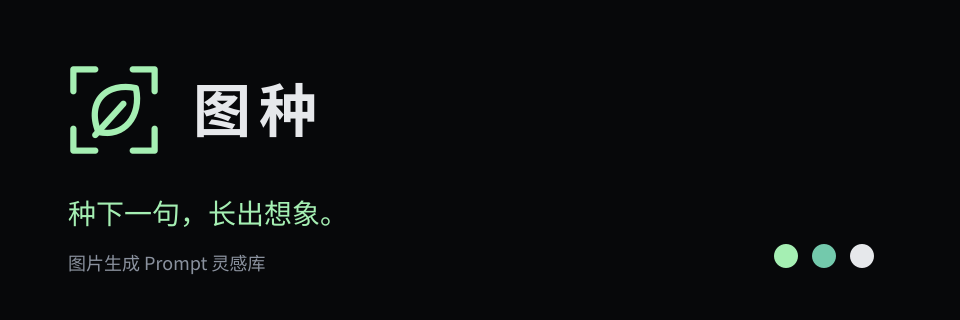

# 图种 · 品牌说明

图种，读作“图 zhǒng”。每一条 Prompt 都是一颗能长出画面的种子。

- 名称：图种。
- 品类说明：图片生成 Prompt 灵感库。
- 品牌口号：种下一句，长出想象。
- 简介：浏览效果图，发现图片背后的提示词与生成条件，复制到自己的工具里探索。
- 语气：简洁、友好、具体，不承诺复制提示词即可得到完全一致的图片。

可编辑矢量预览：[tuzhong.svg](brand/tuzhong.svg)。

## Logo

四角取景框代表图片与发现；中间向右上生长的种子代表提示词孕育画面，斜线表达萌芽与生长方向。图形采用 32 × 32 网格、2 单位圆角描边。

站点组件位于 `src/components/brand/logo-mark.tsx`，使用 currentColor，支持单色应用。浏览器图标位于 `src/app/icon.svg`，采用固定深色底和芽绿图形。修改形状时两处保持一致。

导航采用图标加「图种」字标，中文字使用站点系统字体与适度字距。图标默认 32px，独立图标最小 16px；组合标志四周至少留出图标宽度四分之一的空白。禁止拉伸、旋转、添加厚重阴影或使用低对比配色。

## 色彩

| 用途 | 色值 |
| --- | --- |
| 背景 | #07080A |
| 主品牌色 / 芽绿 | #A5EFB3 |
| 渐变点缀 / 青绿 | #73C9AC |
| 正文 | #E6E8EB |
| 次要文字 | #8A919E |

延续深色画廊布局，图片仍是视觉主体。芽绿用于 Logo、主操作、选中态与焦点；青绿只用于轻微渐变。不通过颜色单独传达交互状态。

## 名称使用范围

公开页面、后台页面标题、关于说明和当前产品文档统一使用「图种」。包名、已有数据库名、环境变量、部署标识和文档路径继续使用现有技术标识，避免品牌更新影响部署。历史任务记录保留当时名称。

本次确定的是品牌设计，未进行商标与域名可用性核查。
